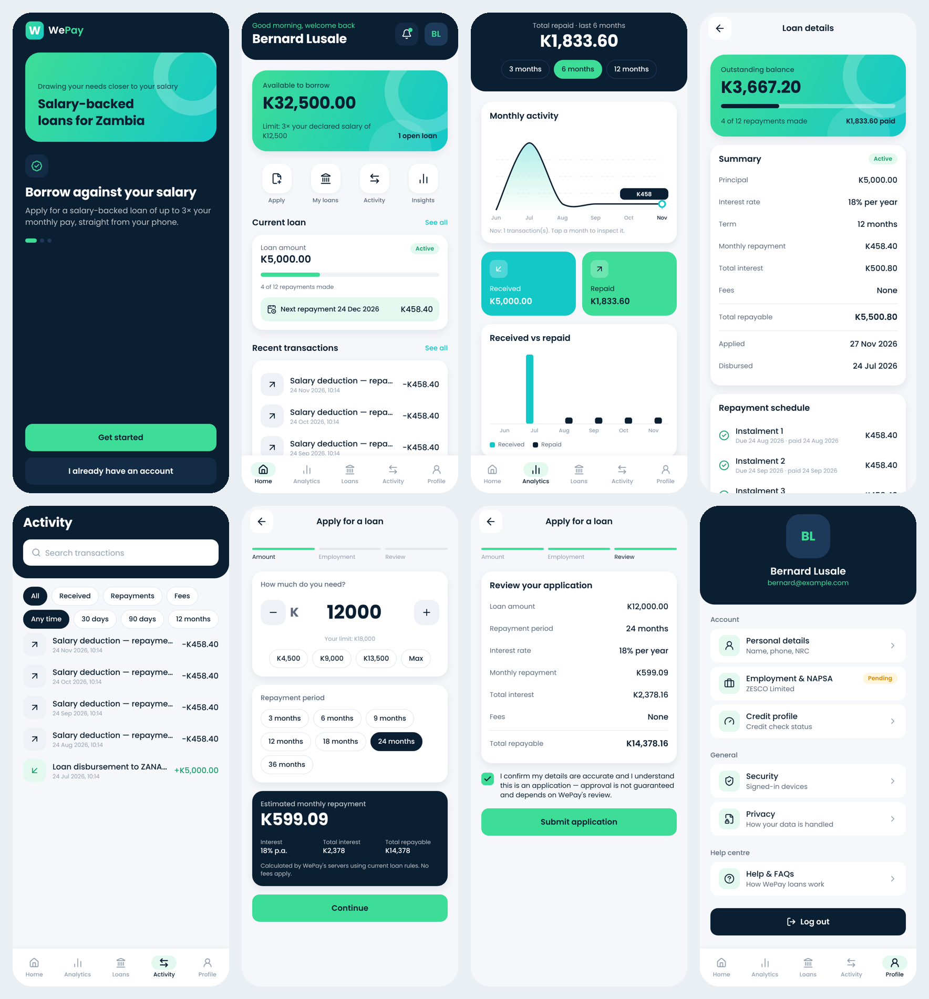

# WePay Android app

Native React Native (Expo SDK 58) client for the WePay salary-backed lending platform. It uses the same Next.js API, database and user accounts as the website. It is a real native app, not a WebView.



## Stack
Expo Router (file-based navigation) · TypeScript · React Query · React Hook Form + Zod · Reanimated 4 · react-native-svg charts · Lucide icons · Poppins · SecureStore (Android Keystore) · NetInfo

## Structure
```
src/
  app/                    routes (Expo Router)
    _layout.tsx           providers, fonts, splash, auth gate (Stack.Protected), error boundary
    (auth)/               welcome · login · register (3 steps) · forgot-password · reset-password
    (app)/(tabs)/         Home · Analytics · Loans · Activity · Profile
    (app)/loans/          apply (amount → employment → review) · [id] detail & schedule
    (app)/transactions/   [id] detail + PDF receipt
    (app)/profile/        personal · employment · credit · security (devices) · privacy · help
    (app)/notifications   account alerts derived from real loan/repayment data
  components/             UI kit, charts, finance widgets, form inputs, screen chrome
  lib/
    api.ts                fetch client: bearer token, single-flight refresh, retry-once on 401
    auth.tsx              session state; restore on launch; logout clears cache
    queries.ts            React Query hooks for every endpoint
    network.ts            NetInfo/AppState → React Query (offline pause, refetch on reconnect)
    secure-storage.ts     SecureStore (Android) · .web.ts in-memory shim for browser previews
    config.ts             EXPO_PUBLIC_API_URL + HTTPS guard
    format.ts             ZMW formatting (K12,500.00), dates, masking
```

## How data stays honest
- All money figures come from the API. Loan quotes are calculated **on the server** (`GET /api/loans/quote`).
- No savings, cards or transfers: the backend doesn't support them, so they aren't in the app.
- If no repayment schedule has been issued, the loan screen shows a schedule clearly labelled **estimated**, and the outstanding balance is not shown.
- Credit score: shown only if a real TransUnion score exists.
- Submitting a loan creates a `PENDING` application. The app never implies approval.

## Security
- Access token (15 min) in memory only. Refresh token (30 days, rotated on every use) in SecureStore.
- Concurrent 401s share **one** refresh call. A replayed refresh token kills the whole session on the server.
- Logout revokes the session on the server and clears all cached data (safe account switching).
- Profile → Security lists signed-in devices and supports "sign out everywhere".
- Release builds refuse non-HTTPS API URLs. `allowBackup` is disabled. Only network permissions are requested.

## Develop
```bash
npm install
cp .env.example .env               # EXPO_PUBLIC_API_URL=http://10.0.2.2:3000 for the emulator
npx expo run:android               # development build (or: npx expo start + Expo Go for SDK 58)
npm run typecheck && npm run lint
```

## Build
See [`docs/DEPLOYMENT.md`](../../docs/DEPLOYMENT.md). In short: set your HTTPS API URL in `eas.json`, then run `npm run build:apk` (installable APK) or `npm run build:aab` (Play Store).
